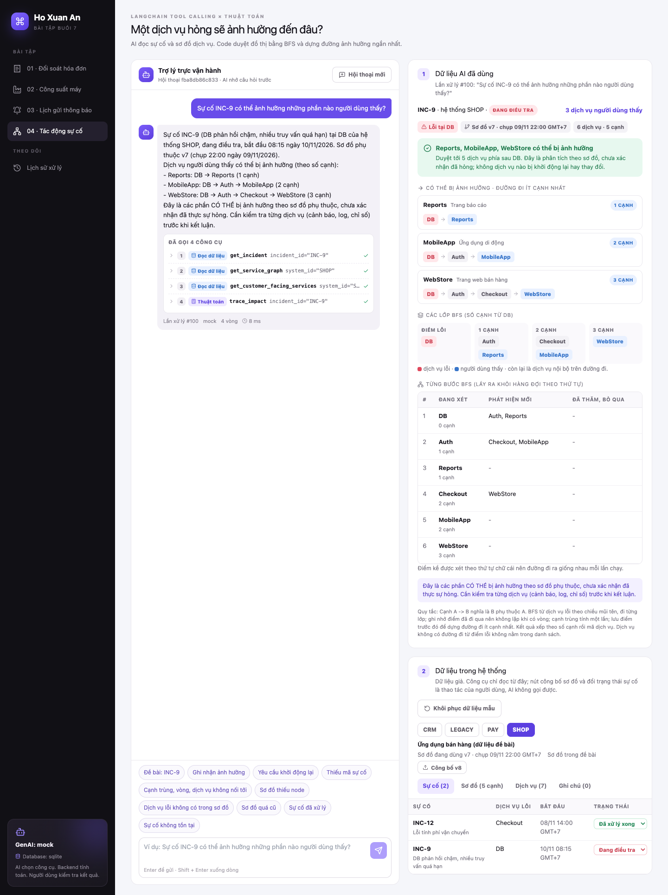

# LangChain Tool Calling × Thuật toán

Bài tập Gen2-AI buổi 7: 4 tình huống doanh nghiệp ghép thành **một web app có ô chat**.

- **AI chọn công cụ**: model đọc câu hỏi, gọi công cụ (`@tool` + `bind_tools`) để lấy dữ liệu từ backend.
- **Backend tính toán**: thuật toán viết bằng Python, đọc lại dữ liệu từ database, không tin số liệu model tự điền.
- **Người dùng kiểm tra**: xem các công cụ đã gọi, dữ liệu đã dùng, và duyệt đề xuất. App không tự thay đổi dữ liệu.

| Bài | Câu hỏi | Thuật toán | Kết quả với dữ liệu đề bài |
|---|---|---|---|
| 01 | Hai khoản chuyển tiền nào trả đủ hóa đơn? | Hash map (hai số có tổng cho trước) | I-77: P1 + P2 = 1.500.000 VND |
| 02 | Cần máy nhanh cỡ nào để kịp ca? | Tìm kiếm nhị phân trên đáp án | Tối thiểu 11 sp/giờ, đề xuất máy M2 (12) |
| 03 | Gửi thông báo khi nào cho hợp lý? | Max-heap + hàng đợi chờ | A1 B1 idle A2 B2 idle A3 B3 |
| 04 | Một dịch vụ hỏng sẽ ảnh hưởng đến đâu? | BFS + lưu điểm trước đó | Reports 1 cạnh, MobileApp 2, WebStore 3 |

## Vì sao GenAI cần gọi công cụ

Model không biết hóa đơn nào còn mở, máy nào đang rảnh, khách nào đã từ chối nhận tin hay sơ đồ dịch vụ hiện tại
là phiên bản nào. Những số liệu đó nằm trong hệ thống và đổi liên tục. Nếu để model tự trả lời, nó sẽ đoán: cộng tiền
sai, bỏ sót một lô hàng, gửi tin cho khách đã từ chối, hoặc suy ra "DB hỏng thì WebStore hỏng" chỉ vì tên nghe giống.

Vì vậy trong app này model chỉ làm phần nó giỏi: hiểu câu hỏi bằng lời thường, chọn đúng công cụ và giải thích kết
quả. Phần cần chính xác thì giao cho code:

- **Công cụ đọc** lấy dữ liệu thật từ database theo mã (hóa đơn, dây chuyền, chiến dịch, sự cố).
- **Công cụ thuật toán** chỉ nhận mã, tự đọc lại dữ liệu rồi tính. Model không truyền được số tiền, số giờ hay danh
  sách cạnh, nên không thể "bơm" số liệu sai vào phép tính.
- **Công cụ đề xuất** chỉ tạo bản nháp chờ người duyệt. Khi duyệt, backend tính lại trên dữ liệu mới nhất.

Kết quả có thể kiểm tra lại: mỗi câu trả lời kèm công cụ đã gọi, tham số, kết quả và các bước của thuật toán.

## Ảnh chụp

| | |
|---|---|
| [Bài 01 - Đối soát hóa đơn](docs/screenshots/01-invoices.png) | [Bài 02 - Công suất máy](docs/screenshots/02-capacity.png) |
| [Bài 03 - Lịch gửi thông báo](docs/screenshots/03-notifications.png) | [Bài 04 - Tác động sự cố](docs/screenshots/04-incidents.png) |
| [Bài 04 - Cạnh trùng, vòng, dịch vụ không nối tới](docs/screenshots/04-incidents-edge-cases.png) | [Bài 04 - Sơ đồ đổi sau khi tạo đề xuất, duyệt bị chặn](docs/screenshots/04-incidents-approval-blocked.png) |
| [Lịch sử xử lý](docs/screenshots/05-history.png) | |



Mỗi trang bài có 3 phần:

1. **Ô chat** bên trái. Dưới mỗi câu trả lời là danh sách công cụ đã gọi, bấm vào để xem tham số và kết quả.
   Đề xuất có nút Duyệt / Từ chối.
2. **Dữ liệu AI đã dùng**: kết quả thuật toán của câu hỏi gần nhất, kèm các bước chạy (thứ tự quét hash map,
   các bước tìm nhị phân, từng ô của heap, từng lớp BFS).
3. **Dữ liệu trong hệ thống**: dữ liệu giả trong database. Có nút đổi dữ liệu (đổi máy, đổi trạng thái đồng ý,
   công bố sơ đồ mới...) để thử ca dữ liệu đổi sau khi AI đã đọc. Các nút này là thao tác của người dùng, AI không gọi được.

## Luồng xử lý một câu hỏi

```
Người dùng hỏi
   │
   ▼
POST /chat ── lưu câu hỏi (chat_runs)
   │
   ▼
model.bind_tools(công cụ của bài) ──► model trả tool_calls
   │                                     │
   │       backend kiểm tra từng lời gọi: tên có trong danh sách? tham số đúng schema?
   │                                     │
   │       chạy công cụ ──► đọc database / chạy thuật toán / tạo đề xuất
   │                                     │
   │       lưu lời gọi (tool_calls) ──► trả ToolMessage đúng tool_call_id
   │                                     │
   └──────────── lặp, tối đa MAX_TOOL_ROUNDS vòng ◄──┘
   │
   ▼
câu trả lời cuối ── lưu lại, hiện trên chat và trang Lịch sử
```

Đề xuất chỉ đổi dữ liệu khi người dùng bấm **Duyệt** (`POST /proposals/{id}/approve`). Model không gọi được endpoint này.

## Tool Calling an toàn

| Yêu cầu của đề | Cách làm |
|---|---|
| `@tool` + `bind_tools`, trả `ToolMessage` đúng `tool_call_id`, lặp có giới hạn | [app/core/agent.py](backend/app/core/agent.py). Quá số vòng thì dừng với trạng thái `max_steps` |
| Kiểm tra tên công cụ và tham số | Tên lạ → lỗi `tool_not_allowed`. Tham số sai kiểu, thừa ô, sai định dạng mã → `invalid_args`. Công cụ không được chạy |
| Không lấy số liệu do model điền | Công cụ thuật toán chỉ nhận mã (`invoice_id`, `line_id`, `campaign_id`, `incident_id`) và tự đọc lại database |
| Không SQL tùy ý, URL tùy ý | Mã đi qua regex chặt (vd `^INC-\d{1,10}$`). Không có công cụ nhận câu lệnh hay đường dẫn |
| Thiếu dữ liệu, lỗi, không có đáp án thì nói rõ | Công cụ trả lỗi có mã (`incident_not_found`, `consent_source_unavailable`...) hoặc trạng thái (`no_machine_fast_enough`, `incomplete_data`...). Câu trả lời nêu đúng lý do |
| Hành động thay đổi dữ liệu chỉ là đề xuất | `propose_*` tạo bản ghi `pending_approval`. Khi duyệt, backend tính lại; dữ liệu đã đổi thì trả 409 và đề xuất vẫn chờ |
| Không tự gửi tin, chuyển tiền, sửa hệ thống | Không có công cụ hay API nào làm việc đó. Hỏi "gửi ngay", "khởi động lại DB" thì AI giải thích chỉ phân tích/đề xuất |
| Chạy thử không cần API key | Để trống `OPENAI_API_KEY` thì dùng model giả lập: gọi đúng các công cụ như model thật nên làm |
| Lưu lại để kiểm tra | Bảng `chat_runs`, `tool_calls`, `proposals`. Trang **Lịch sử xử lý** hiện câu hỏi, công cụ, kết quả thuật toán, câu trả lời |
| API key chỉ ở backend | Trình duyệt gọi `/api/...`, Next.js chuyển tiếp sang FastAPI. Frontend không đọc key |

## Từng bài

### Bài 01 - Đối soát hóa đơn

- **Công cụ:** `get_open_invoice` → `list_unmatched_transfers` → `find_two_transfer_match` → (`propose_invoice_match`)
- **Thuật toán:** chỉ xét giao dịch chưa ghép, cùng khách, cùng loại tiền. Quét theo giờ nhận với hash map
  `{số tiền: giao dịch}`; gặp khoản `x` mà đã có `thiếu - x` thì có cặp. Chọn cặp hoàn tất sớm nhất. O(n).
- **Ca biên trong dữ liệu mẫu:** hóa đơn không tồn tại, đã thanh toán, không có cặp, hai giao dịch cùng số tiền,
  giao dịch đã ghép trước (USD), chỉ có một giao dịch, thiếu mã hóa đơn, khác khách / khác loại tiền.

### Bài 02 - Công suất máy

- **Công cụ:** `get_open_batches` + `get_shift_hours` + `get_available_machines` → `calculate_min_required_rate` → (`propose_machine_booking`)
- **Thuật toán:** lô `q` sản phẩm ở tốc độ `r` mất `ceil(q / r)` giờ. Tốc độ kịp thì tốc độ lớn hơn cũng kịp,
  nên tìm `r` nhỏ nhất bằng tìm kiếm nhị phân trên `[1, max(q)]`. Chọn máy rảnh chậm nhất vẫn đạt. O(n log max(q)).
- **Ca biên:** không còn lô, lô 0 sản phẩm, vừa đúng hạn, không máy nào đủ nhanh, ca còn ít giờ hơn số lô,
  ca đã hết giờ, ca của dây chuyền khác, dây chuyền không tồn tại.
- **Thử dữ liệu đổi:** sửa tốc độ / trạng thái máy sau khi tạo đề xuất → duyệt bị chặn.

### Bài 03 - Lịch gửi thông báo

- **Công cụ:** `get_pending_messages` + `get_contact_policy` → `get_opt_in_status` → `build_send_schedule` → (`propose_send_schedule`)
- **Thuật toán:** loại tin của khách chưa đồng ý. Max-heap theo số tin còn lại (bằng nhau thì theo mã khách),
  khách vừa nhận tin vào hàng đợi chờ `gap` ô. Không ai sẵn sàng thì ô đó idle. O(n log k).
- **Ca biên:** khách từ chối / chưa có bản ghi đồng ý, một khách, `gap = 0`, nhiều khách cùng số tin,
  hết giờ còn tin, nguồn dữ liệu đồng ý không phản hồi, không còn ai nhận, chiến dịch không tồn tại.
- **Thử dữ liệu đổi:** đổi trạng thái đồng ý của khách hoặc tắt nguồn dữ liệu đồng ý.
- "Gửi ngay" không gửi gì: app chỉ đề xuất lịch, duyệt thì ghi giờ gửi dự kiến.

### Bài 04 - Tác động sự cố

- **Công cụ:** `get_incident` → `get_service_graph` + `get_customer_facing_services` → `trace_impact` → (`propose_impact_note`)
- **Thuật toán:** cạnh `A → B` nghĩa là B phụ thuộc A. BFS từ dịch vụ lỗi theo chiều mũi tên, ghi nhớ điểm đã
  đi qua (không lặp khi có vòng), lưu điểm trước đó để dựng đường đi ít cạnh nhất. Cạnh trùng tính một lần,
  điểm kề xét theo alphabet để kết quả ổn định. O(V + E).
- **Ca biên:** cạnh trùng, vòng `Ledger ⇄ Payout`, dịch vụ không có đường đi tới, sơ đồ thiếu dịch vụ người dùng
  thấy / có dịch vụ lạ (`incomplete_data`), dịch vụ lỗi không có trong sơ đồ, sơ đồ chụp quá 30 ngày,
  sự cố đã xử lý xong, sự cố không tồn tại.
- **Thử dữ liệu đổi:** công bố sơ đồ v8 sau khi tạo đề xuất → duyệt bị chặn ("sơ đồ đã đổi từ v7 sang v8").
- "Khởi động lại DB" không làm gì: AI giải thích bài này chỉ phân tích.

## Cài đặt và chạy

Cần có Python 3.12 và Node.js 20 trở lên.

### Backend

```bash
cd backend
python3.12 -m venv myenv
myenv/bin/pip install -r requirements.txt
cp .env.example .env
myenv/bin/uvicorn app.main:app --reload --reload-dir app --port 8000
```

Để trống `OPENAI_API_KEY` (hoặc `MOCK_LLM=true`) thì app chạy bằng model giả lập, không cần API key.
Để trống `DB_HOST` thì app dùng SQLite tại `backend/data/app.db`. Lần đầu chạy, app tự tạo bảng và nạp dữ liệu mẫu.

Swagger UI: http://localhost:8000/docs

### Frontend

```bash
cd frontend
npm install
npm run dev
```

Mở http://localhost:3000. Trình duyệt gọi `/api/...`, Next.js chuyển tiếp sang FastAPI ở `BACKEND_INTERNAL_URL`
(mặc định `http://localhost:8000`). API key chỉ nằm ở backend.

### Chạy với model thật

Trong `backend/.env`:

```
OPENAI_API_KEY=sk-...
OPENAI_MODEL=gpt-4o-mini
MOCK_LLM=false
```

Khởi động lại backend. Góc trái dưới của web app hiện tên model đang dùng. Để chạy hết câu hỏi mẫu của 4 bài
một lượt và xem model gọi công cụ nào:

```bash
cd backend
myenv/bin/python scripts/run_samples.py
```

Script khôi phục dữ liệu mẫu trước mỗi bài, không duyệt đề xuất nào. Mọi lần chạy đều xem lại được ở trang Lịch sử xử lý.

### Dùng Supabase PostgreSQL

Điền các biến `DB_*` trong `backend/.env` (lấy ở Supabase: Project Settings > Database > Connection parameters).
Không cần tạo bảng trước, app tự tạo khi khởi động.

## Test

```bash
cd backend
myenv/bin/python -m pytest -q
```

708 test, không gọi model thật, mỗi test dùng SQLite tạm:

| Nhóm | Số test | Kiểm tra gì |
|---|---|---|
| `test_*_algo.py` | 441 | Thuật toán từng bài: ca đề bài, ca biên, so với cách vét cạn / Bellman-Ford trên dữ liệu ngẫu nhiên, dữ liệu lớn |
| `test_*_tools.py` | 114 | Công cụ: đọc đúng dữ liệu, chặn tham số lạ, đọc lại database, phát hiện dữ liệu đổi, đề xuất không ghi dữ liệu thật |
| `test_*_api.py`, `test_chat_api.py` | 123 | Luồng chat qua API: thứ tự gọi công cụ, câu trả lời, duyệt / từ chối, xung đột 409, khôi phục dữ liệu |
| `test_agent.py`, `test_config.py` | 30 | Vòng lặp tool calling: tên lạ, tham số sai, quá số vòng, model lỗi, đọc cấu hình |

## Cấu trúc thư mục

```
backend/
  app/
    core/            Phần dùng chung: vòng lặp tool calling, model giả lập, lưu lịch sử, đề xuất, API chung
    modules/<bài>/   Mỗi bài: algo.py (thuật toán), tools.py (công cụ), planner.py (model giả lập),
                     agent.py (prompt + duyệt đề xuất), entities.py, store.py, router.py (API phụ)
  samples/           Dữ liệu mẫu JSON của 4 bài, gồm câu hỏi mẫu
  scripts/           run_samples.py: chạy hết câu hỏi mẫu qua backend
  tests/
frontend/
  app/               Trang chính và proxy /api/[...path] sang FastAPI
  components/        chat.tsx (ô chat dùng chung), trang từng bài, history.tsx (lịch sử)
  lib/               Gọi API, kiểu dữ liệu, định dạng giờ / tiền
docs/screenshots/    Ảnh chụp các trang
```

Chi tiết API và cách thêm một bài: [backend/README.md](backend/README.md).

## Dữ liệu

Mọi hóa đơn, giao dịch, lô hàng, khách hàng và dịch vụ trong `backend/samples/` đều là dữ liệu giả để luyện tập.
Mỗi trang có nút **Khôi phục dữ liệu mẫu**; đề xuất đang chờ của bài đó sẽ được đóng vì tạo trên dữ liệu cũ.
